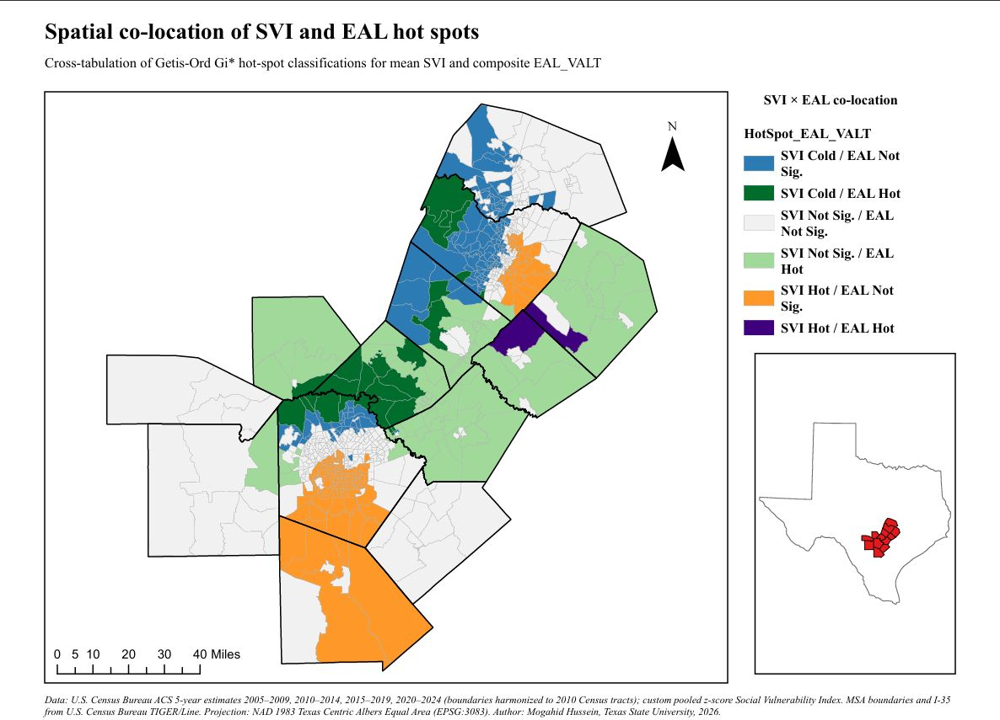
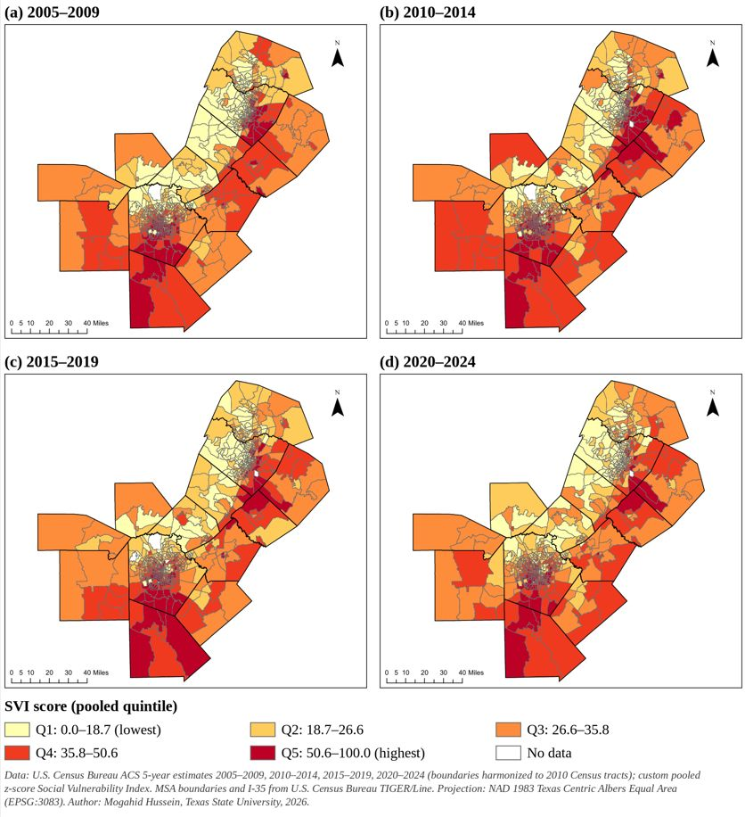
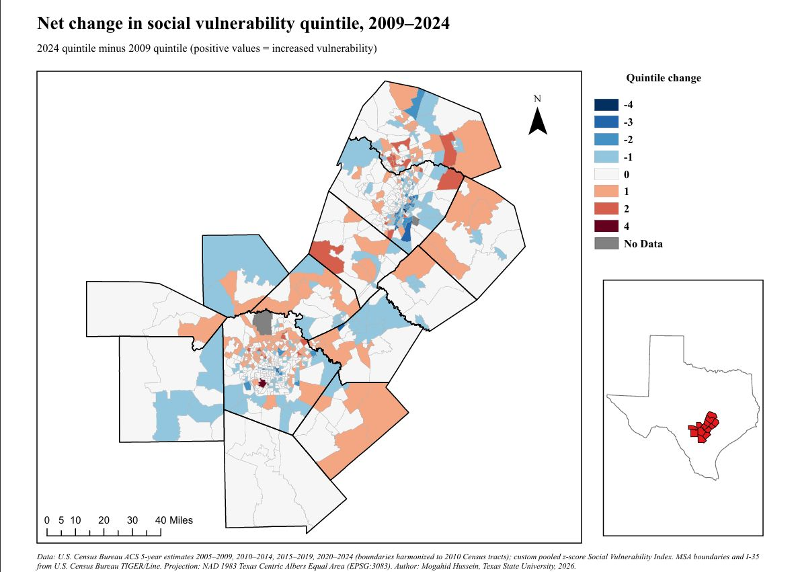
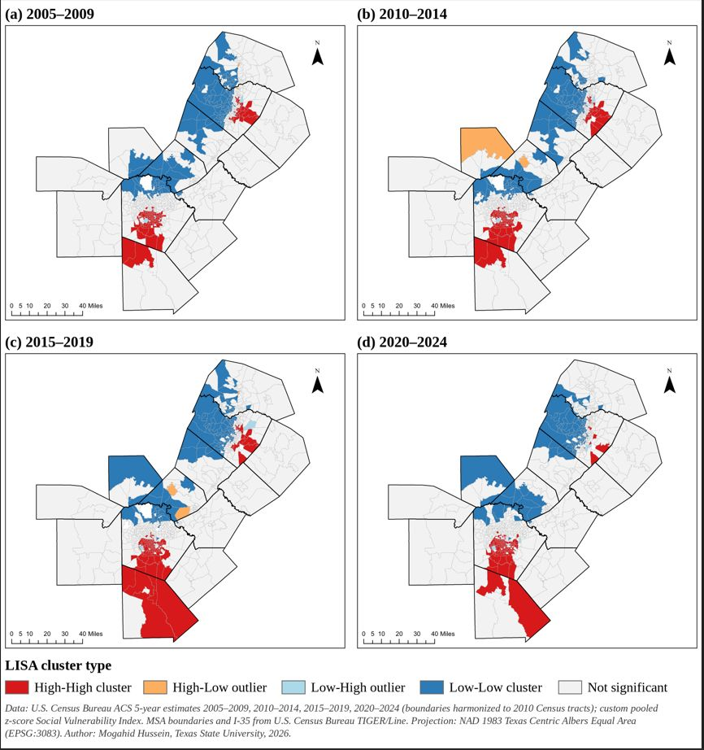
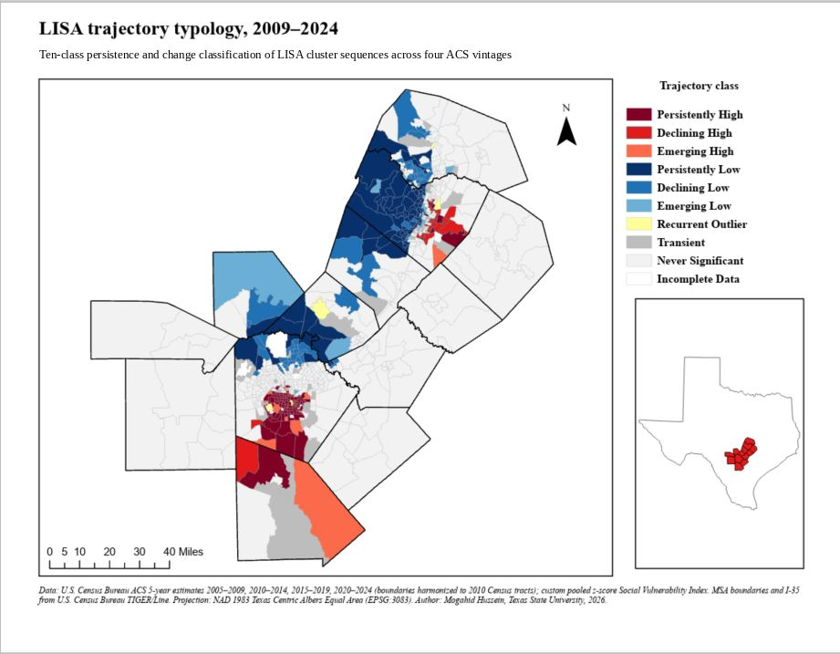
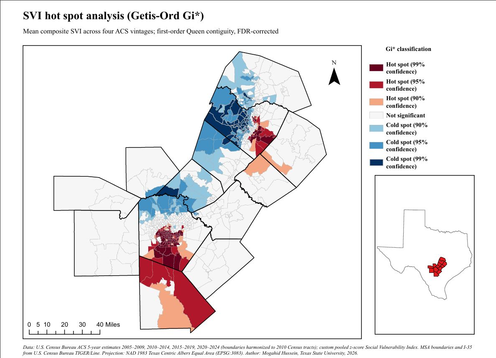
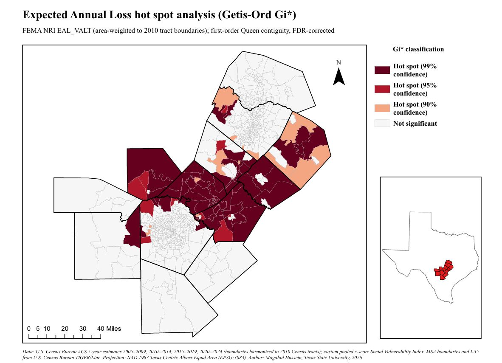
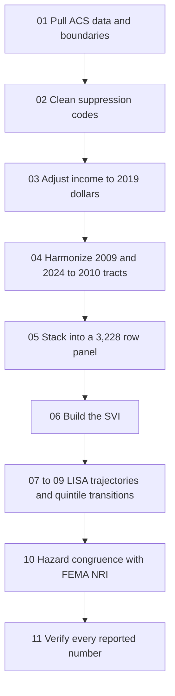

# Longitudinal Social Vulnerability Index for Texas Metro Areas (2009 to 2024)

[](https://github.com/MoPhD26/texas-svi-pipeline/actions/workflows/ci.yml)


The analytical pipeline behind my doctoral dissertation at Texas State University:
**Spatiotemporal Social Vulnerability in the Austin–San Antonio Metropolitan Corridor: Persistence, Change, and Hazard Congruence, 2009–2024** (December 2026).

Most social vulnerability studies capture a single moment, which makes it hard to tell lasting disadvantage from temporary strain. This project builds a Social Vulnerability Index (SVI) that can be compared across fifteen years at the census tract level, tracks where vulnerability persisted and where it changed, and tests whether the places with persistent vulnerability are the same places FEMA models as facing the largest hazard losses.



## Study area and data

* 13 counties in the San Antonio-New Braunfels and Austin-Round Rock-San Marcos metro areas, Texas
* 807 census tracts on 2010 boundaries, more than 5.2 million residents
* American Community Survey 5-year estimates for 2005-2009, 2010-2014, 2015-2019, and 2020-2024
* FEMA National Risk Index v1.20 Expected Annual Loss and the National Flood Hazard Layer

## Research questions and findings

### RQ1. How did the spatial distribution of social vulnerability change between 2009 and 2024?

Corridor-wide vulnerability leveled out slightly. The mean SVI moved from +0.026 to -0.051, and tract scores became less spread out. Underneath that average, the two metro areas diverged.

* **Austin:** inner-city tracts, especially in East Austin, moved toward lower vulnerability while outer counties such as Bastrop rose, a pattern consistent with displacement pressure. Travis County's average fell by 0.21 units.
* **San Antonio:** high vulnerability stayed concentrated in Bexar County and parts of the rural south.
* **Staying in the top quintile:** of tracts in the most vulnerable fifth in 2009, **69 percent** in San Antonio were still there in 2024, compared with **26 percent** in Austin.

| Social vulnerability by period | Net change, 2009 to 2024 |
|---|---|
|  |  |

### RQ2. How persistent are high-vulnerability clusters, and where are they?

Local Moran's I (LISA) clusters were computed for each period, and each tract was classified into one of 10 trajectory classes based on its sequence of cluster types.

* **98 tracts stayed in high-vulnerability clusters at all four time points**, 12 percent of the corridor. **90 of them are in San Antonio**, concentrated on the West, South, and inner-East Sides of Bexar County. Austin has 8.
* **92 tracts stayed in low-vulnerability clusters**, and 78 of those are in Austin.

| LISA clusters by period | Trajectory typology, 2009 to 2024 |
|---|---|
|  |  |

### RQ3. Do persistently vulnerable tracts coincide with high modeled hazard loss?

Largely, no. Hot spots of mean SVI and of FEMA Expected Annual Loss (EAL) were mapped with Getis-Ord Gi* (first-order Queen contiguity, FDR corrected).

| | San Antonio | Austin | Corridor |
|---|---|---|---|
| SVI hot spots | 145 | 43 | 188 |
| EAL hot spots | 66 | 33 | 99 |
| Hot spots for both | 0 | 2 | **2** |

* Only **2 of 188** SVI hot spot tracts are also EAL hot spots, against about 23 expected if the two patterns were unrelated.
* None of the 98 persistently high tracts is an EAL hot spot.
* FEMA's loss model is driven largely by property value. Building losses make up about 55 percent of total EAL in the corridor, and property values are higher in less vulnerable places.
* EAL hot spots also had more mapped floodplain: 67.7 percent had at least a tenth of their land in a Special Flood Hazard Area, compared with 35.1 percent of SVI hot spots.

**Why it matters:** if mitigation funding follows modeled dollar losses alone, it will tend to flow toward wealthier places and away from the communities least able to recover. Loss models and vulnerability measures answer different questions, and equity-informed planning needs both.

| SVI hot spots | EAL hot spots |
|---|---|
|  |  |

All eight dissertation maps are in the [map gallery](docs/MAPS.md).

## Methods

**Harmonizing fifteen years of data.** Census tracts were redrawn in 2010 and 2020, so the 2009 and 2024 data are moved onto 2010 tracts with the Census Bureau's relationship files. Counts are split by land-area share, margins of error are combined by root sum of squares, and income is averaged by population. Suppression codes are removed before any calculation, and income is converted to 2019 dollars with BLS CPI-U annual averages.

**A comparable index.** Twelve indicators in four themes (socioeconomic status, household composition, minority status and language, housing and transportation) are standardized with pooled z-scores across all 3,228 tract-year observations at once. A score in 2009 is directly comparable to a score in 2024, which within-year percentile rankings such as the CDC SVI cannot provide (Tate 2012, Spielman and Folch 2015). Tracts with unreliable estimates (coefficient of variation above 40 percent) are flagged, and a sensitivity test checks the effect of leaving out unemployment.

**Persistence.** LISA cluster types for each period are combined into a 10-class trajectory typology. Quintile transition matrices measure how tracts moved between vulnerability levels.

**Hazard congruence.** FEMA EAL is crosswalked from 2020 to 2010 tracts and compared across trajectory classes (Kruskal-Wallis, Dunn's post hoc test with Benjamini-Hochberg correction), across quintiles (chi-square, Cramér's V), and between metro areas (Mann-Whitney U). Hot spots use Getis-Ord Gi* with FDR correction, and a separate Python script reproduces every reported number as an independent check on the ArcGIS Pro results.

## Pipeline



| Step | Script | Purpose |
|---|---|---|
| 01 | [`01_census_acs5_pull.py`](src/01_census_acs5_pull.py) | Pulls ACS tables for every tract in the 13 counties through the Census API and downloads TIGER/Line boundaries |
| 02 | [`02_clean_sentinel_values.py`](src/02_clean_sentinel_values.py) | Replaces Census suppression codes with NaN and logs every replacement |
| 03 | [`03_adjust_income_cpi.py`](src/03_adjust_income_cpi.py) | Converts income and its margin of error to 2019 dollars |
| 04 | [`04_crosswalk_to_2010.py`](src/04_crosswalk_to_2010.py) to [`04d`](src/04d_crosswalk_cleanup.py) | Harmonizes 2009 and 2024 to 2010 tracts, checks variable definitions across vintages, and validates all 807 tracts |
| 05 | [`05_stack_longitudinal.py`](src/05_stack_longitudinal.py) | Stacks the four periods into one analysis-ready panel |
| 06 | [`06_build_svi_index.py`](src/06_build_svi_index.py) | Computes the indicators, pooled z-scores, composite and theme scores, uncertainty flags, and labeled GeoPackages |
| 07 to 09 | *being added* | LISA clusters, trajectory typology, and quintile transition matrices |
| 10 | [`10_hazard_congruence.py`](src/10_hazard_congruence.py) | Brings FEMA Expected Annual Loss onto 2010 tracts and runs the RQ3 statistical tests |
| 11 | [`11_verify_section_6_3.py`](src/11_verify_section_6_3.py) | Reproduces the hot spot counts and RQ3 results in Python from the source data |

Maps were produced in ArcGIS Pro 3.6 from the pipeline's GeoPackage outputs.

## How to run

```bash
pip install -r requirements.txt

# Get a free key at https://api.census.gov/data/key_signup.html
export CENSUS_API_KEY="your_key_here"

for y in 2009 2014 2019 2024; do ACS_YEAR=$y python src/01_census_acs5_pull.py; done
python src/02_clean_sentinel_values.py
python src/03_adjust_income_cpi.py
python src/04_crosswalk_to_2010.py
python src/04a_fix_wilson_county.py
python src/04b_add_wilson_passthrough.py
python src/04c_finalize_wilson.py
python src/04d_crosswalk_cleanup.py
python src/05_stack_longitudinal.py
python src/06_build_svi_index.py

# Steps 10 and 11 need the FEMA NRI tract CSV in data/nri/
# and the 2020-to-2010 tract relationship file in data/crosswalk/
python src/10_hazard_congruence.py
python src/11_verify_section_6_3.py
```

On Windows PowerShell, set variables with `$env:CENSUS_API_KEY="your_key_here"` and `$env:ACS_YEAR="2009"`.

## Tests

33 automated tests check the core methods on small synthetic examples, with no data download needed: suppression code cleaning, inflation factors, crosswalk totals and margins of error, the stacked panel, the FEMA loss crosswalk, Dunn's test corrections, and the Gi* significance bins. GitHub Actions runs them on every push.

```bash
pip install -r requirements.txt -r requirements-dev.txt
pytest -v
```

## Tools

Python (pandas, NumPy, GeoPandas, SciPy, PySAL, statsmodels), ArcGIS Pro 3.6, U.S. Census Bureau API, TIGER/Line, Census tract relationship files, BLS CPI-U, FEMA National Risk Index, FEMA National Flood Hazard Layer.

## Author

**Mogahid Hussein, Ph.D., GISP**
Ph.D. in Geographic Information Science, Texas State University. Committee: Ron Hagelman III (chair), Alberto Giordano, Edwin Chow, Brendan Lavy.

As disclosed in the dissertation, I used an AI assistant to help write and debug parts of this code. I designed the pipeline, ran every step, and verified every reported number against the source data.

See also: [arcpy-incident-response-toolkit](https://github.com/MoPhD26/arcpy-incident-response-toolkit) and [arcade-shelter-operations](https://github.com/MoPhD26/arcade-shelter-operations).

## License

Code is released under the MIT License. Maps are © 2026 Mogahid Hussein. ACS, TIGER/Line, and relationship files are public domain products of the U.S. Census Bureau. NRI and NFHL data are from FEMA.
