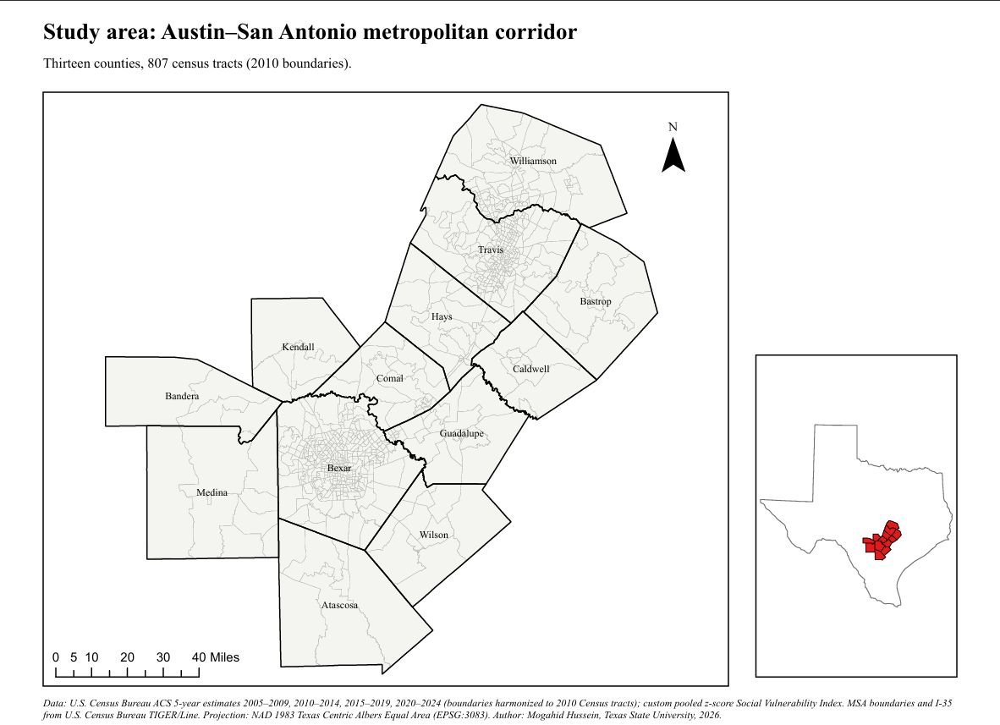
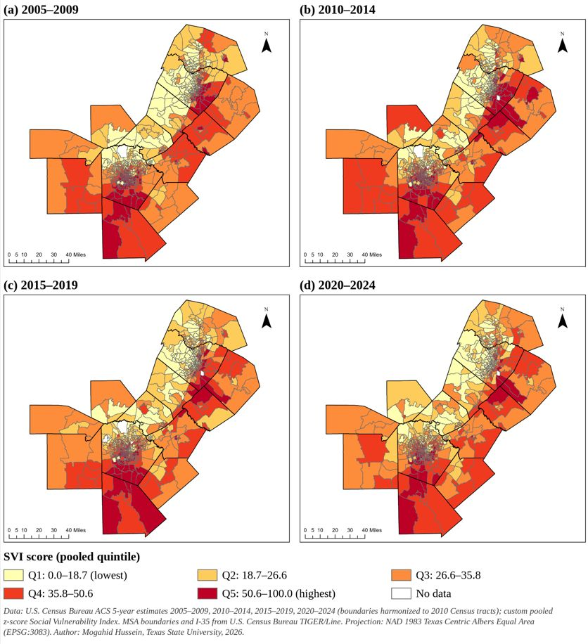
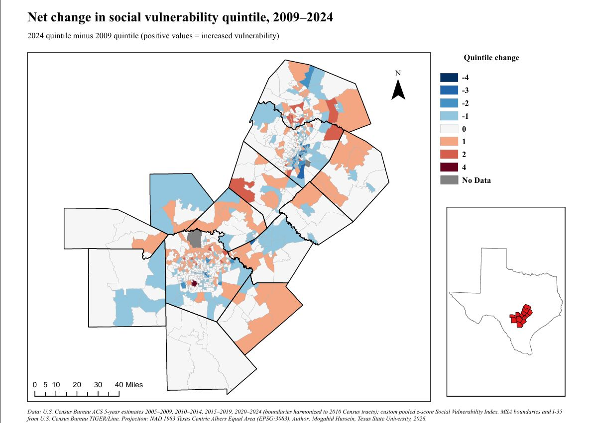
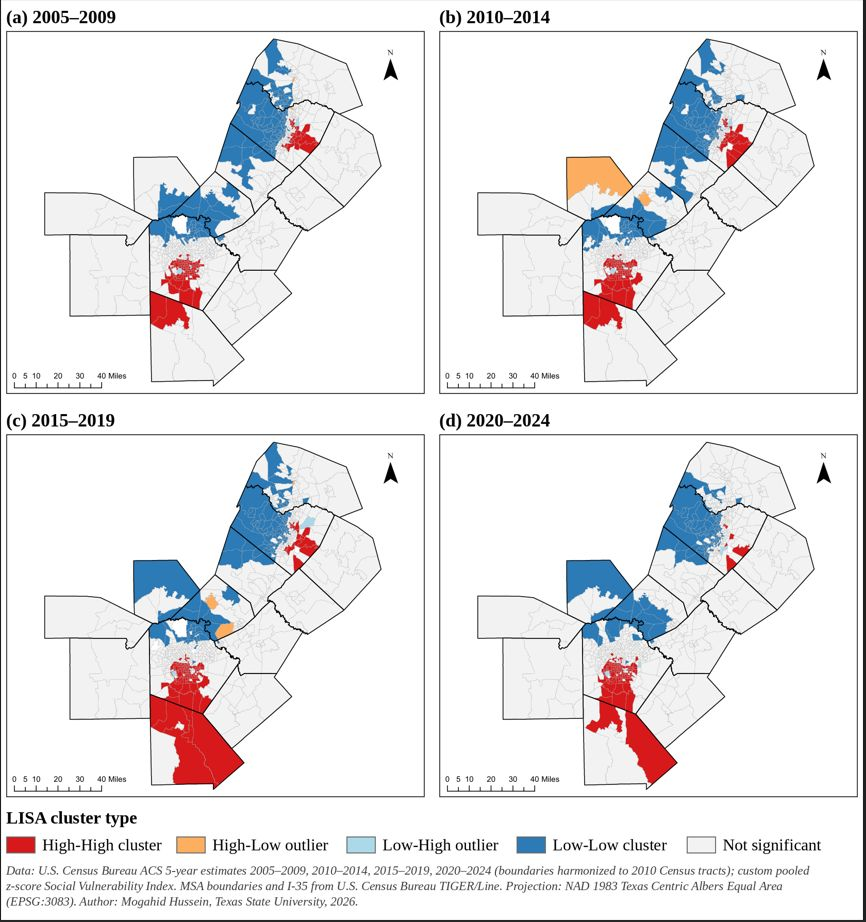
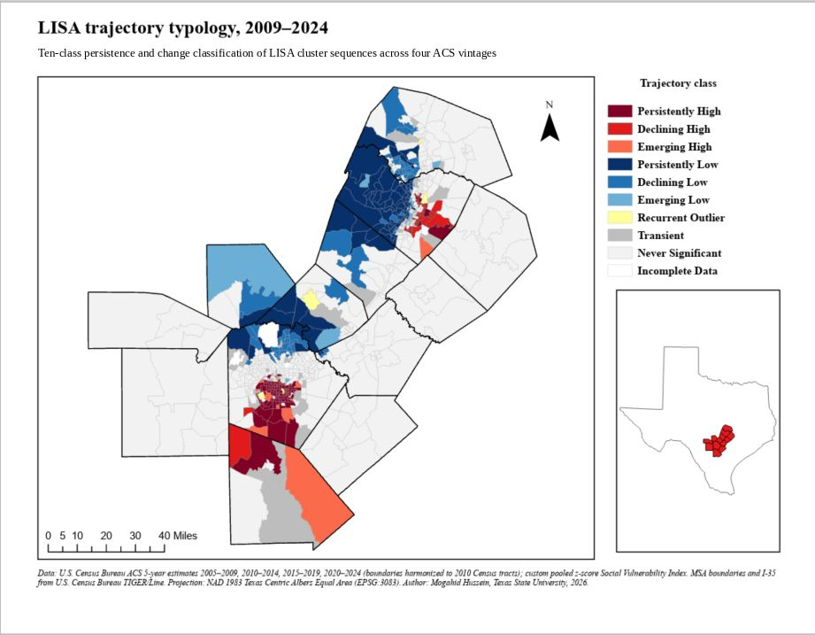
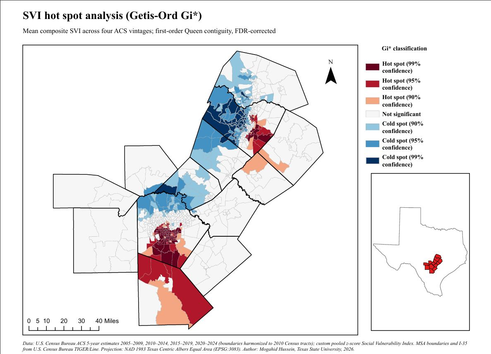
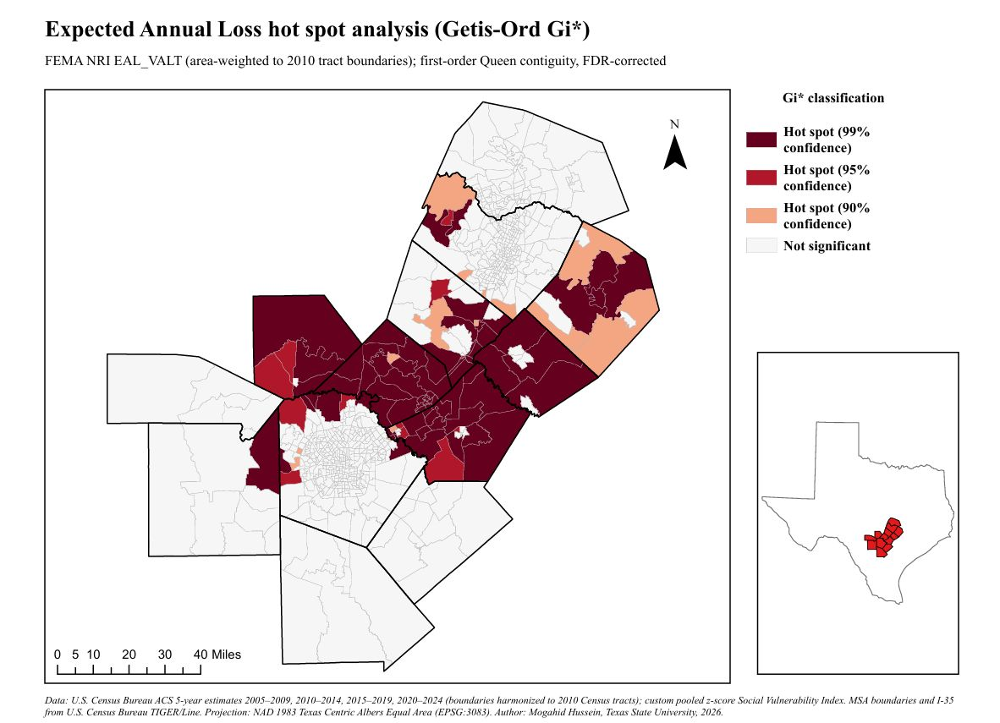
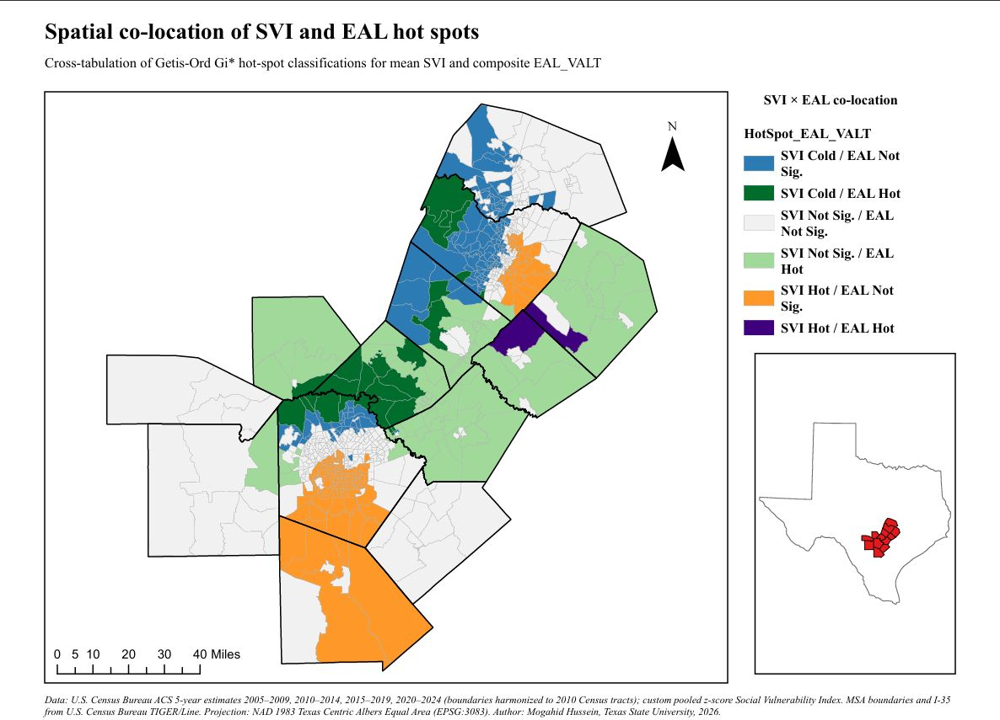

# Map gallery

All maps were produced in ArcGIS Pro 3.6 from the pipeline outputs, on 2010 census tract boundaries, projected to NAD 1983 Texas Centric Albers Equal Area (EPSG 3083). Figure numbers match the dissertation.

## Figure 1. Study area

The 13-county Austin-San Antonio corridor and its 807 census tracts.

## Figure 2. Social vulnerability by ACS period

Pooled z-score SVI for 2005-2009, 2010-2014, 2015-2019, and 2020-2024, shown in quintiles of the pooled distribution so colors mean the same thing in every panel.

## Figure 3. Net change in vulnerability quintile, 2009 to 2024

Positive values mean a tract moved into a higher vulnerability quintile.

## Figure 4. LISA clusters by period

Local Moran's I clusters of social vulnerability for each period.

## Figure 5. LISA trajectory typology, 2009 to 2024

Each tract is classified into one of 10 trajectory classes by its sequence of LISA cluster types across the four periods. Persistently High tracts were in high-vulnerability clusters every time.

## Figure 6. SVI hot spots

Getis-Ord Gi* hot spots of mean SVI across the four periods, first-order Queen contiguity, FDR corrected.

## Figure 7. Expected Annual Loss hot spots

Getis-Ord Gi* hot spots of FEMA NRI composite Expected Annual Loss, crosswalked to 2010 tracts.

## Figure 8. Co-location of SVI and EAL hot spots

Only 2 of 188 SVI hot spot tracts are also EAL hot spots.

